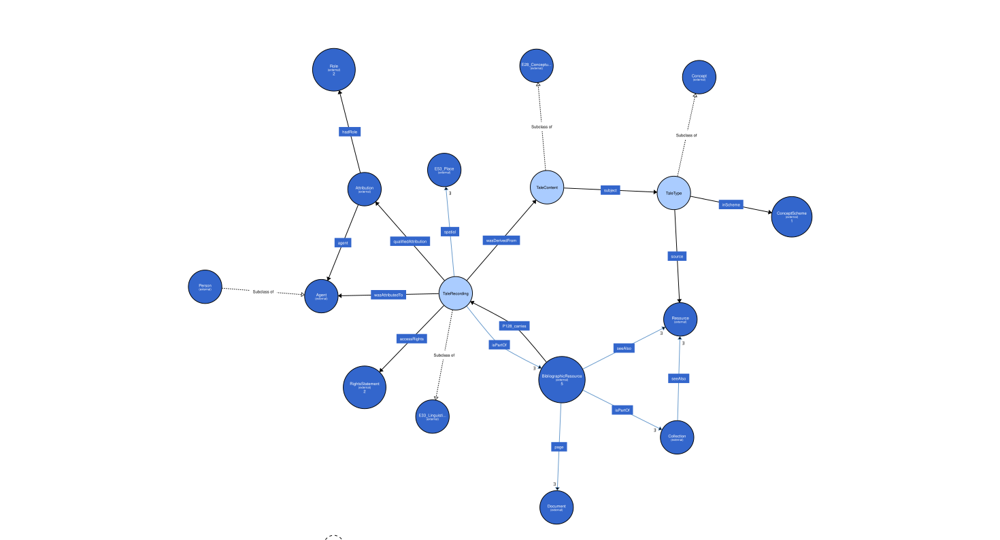

# MagicTagger: Open Infrastructure for Computational Analysis of Russian Folktales

**MagicTagger** is an early-stage research prototype for folklorists and DH researchers.  
It provides ATU Top-3 suggestions for Russian-language folktale texts and reproducible Linked Data exports (JSON-LD) with lightweight provenance (PROV-O) and a clear governance trail (model vs expert decision).

> **Status:** work in progress (research prototype).  
> Exports are downloaded explicitly by the user.

- **Demo:** https://magictagger-1.streamlit.app  
- **Knowledge graph:** https://eugeniavd.github.io/magic_tagger/rdf/  
- **Paper:** Vdovichenko, Evgeniia. “Unlocking Russian Folklore: FAIR Infrastructure for Computational Access to Russian-Language Folktales in the Estonian Folklore Archives.” *DHNB 2026 Post-Proceedings*, forthcoming.

---

## 1. Goal

Provide a small, self-contained workbench that allows a researcher to:

- explore a curated corpus of Russian-language folktales,
- obtain Top-3 ATU type suggestions for an external Russian text,
- optionally override the model decision and export the final decision with provenance,
- export LOD-ready packages (JSON-LD per run / item; additional serializations for reuse).

The emphasis is on reproducibility (versioned corpus, stable label-set/policy pointers, dataset snapshot identifiers).

---

## 2. Corpus and Classifier

The knowledge graph describes 97 Russian-language magic tales from three collections of the Estonian Folklore Archives (“ERA, Vene”, “RKM, Vene” and “TRÜ, VKK”), with 85 ATU type concepts and 122 persons (4,267 triples).

The classifier was trained on 40 tales and evaluated on a held-out set of 10, so the results are preliminary. The model was evaluated with two inputs, the tale text and its description from the archival catalogue: for 6 of the 10 test tales, an archival type was among the Top-3 suggestions. The Classify workflow submits the text only; used this way, the same model reached 3 of 10. Training on the text alone and retrieval of similar variants are planned.

To reproduce the figures reported in the paper, run from the repository root (requires pandas, numpy and scikit-learn):

```bash
python3 scripts/check_numbers.py
```

---

## 3. Ontology

The current ontology for MagicTagger is available below as preview.



**OWL File:** [rft.owl](rdf/rft.owl)

---

## 4. Licensing

MagicTagger distinguishes between **archival source materials**, **derived data**, and **code**.

- **Archival source materials (Estonian Folklore Archives)**:  
  The original materials are provided by the Estonian Folklore Archives and remain under the archive’s rights and access conditions. The repository includes recognised and transcribed texts of the tales sampled for the classifier and a few sample page images from open records; these are not covered by the licences below. Each tale record carries `dcterms:accessRights`: `rft:rights_open` (78 records) or `rft:rights_partly_anonymised` (19 records, all from “TRÜ, VKK”). These restrictions reflect source constraints and must be respected in any reuse.

  For the 78 open records, narrators and collectors appear under their names as recorded in the archival catalogue. For the 19 partly anonymised records, narrators and collectors are published in pseudonymised form until the archive issues a decision on public disclosure of personal names: person entries expose stable pseudonymous IDs (e.g., nar002, col015) and non-identifying attributes only, in the knowledge graph, the corpus index and the tale texts. No person entry is shared between open and partly anonymised records. The name mapping table is held by the author and is not shipped in this repository or exports.

- **Derived data (RDF / exports produced by this project)**:  
  The derived metadata and RDF knowledge graph exports generated by this project are released under **ODbL 1.0**.

- **Code**:  
  The source code is released under the **MIT License**.

- **Software stack**:  
  Built with **Streamlit** and **Python** (plus supporting libraries included in the repository).

---

## 5. Contact

vdovich.evgeniia@gmail.com
